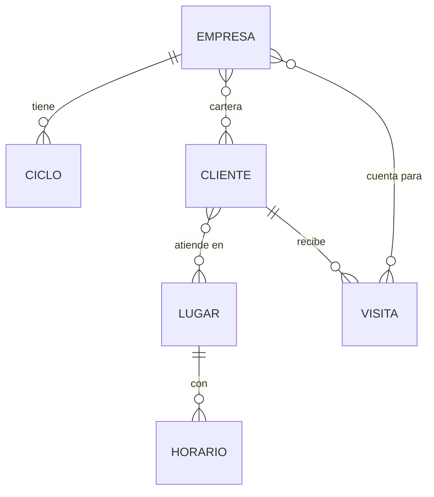

<p align="center">
  
</p>

App Android para visitadores en terreno (visitadores médicos y oficios similares). Importa el kardex de clientes desde Excel, controla las visitas de cada ciclo por empresa y calcula la ruta óptima del día según los horarios de atención de cada cliente.

Funciona **100% dentro del teléfono**: sin servidor, sin cuentas y sin que los datos salgan del dispositivo. Rutas y mapas también son offline.

> **Estado:** Hito 2 terminado. El prototipo es navegable con datos de ejemplo y calcula rutas reales sin internet; está en validación con visitadores. Hito 3 terminado (falta la validación con visitadores): optimizador de ruta, importador del kardex, corrección de ubicaciones en el mapa, descarga de mapas por región y respaldo cifrado.
>
> Avance del proyecto: [tablero en Trello](https://trello.com/b/AAhJ7hXT/visenda).

## Capturas

Con los datos de ejemplo de la app (clientes ficticios).

<!-- Sin tabla: en una tabla GitHub ajusta cada columna al texto y las imágenes quedan de distinto tamaño. -->
<p align="center">
  
  
  
</p>
<p align="center">
  
  
  
</p>

- **Inicio:** avance del ciclo por empresa, alertas de riesgo y la guía para quien empieza.
- **Clientes:** ordenados por estado y filtrables por empresa.
- **Perfil:** avance y visitas por ciclo de cada empresa, consultas con su horario y datos del kardex.
- **Planificar:** sugerencias según urgencia, km y horario, con el motivo de cada una.
- **Ruta:** mapa offline, con hora de salida, llegada a cada parada, colación y vuelta.
- **Ajustes:** primeros pasos, guía de uso, empresas, kardex, mapas, planificación y seguridad.

## Funciones

**Ya funcionan:**

- **Importar el kardex** desde `.xlsx`: propone qué es cada columna, agrupa las filas de un mismo cliente con varias oficinas, entiende los horarios más comunes y deja "por revisar" los que no. Reimportar actualiza sin duplicar ni borrar visitas. Las direcciones se ubican solas con el geocodificador de Android. Incluye una guía para preparar la planilla, con ejemplos de cómo debe verse, y una plantilla `.xlsx` para descargar.

- **Ciclos por empresa**, con frecuencias por categoría y aviso de clientes en riesgo antes del cierre del ciclo. Un médico puede tener sus propias visitas por ciclo, que se cambian en su perfil y se conservan al reimportar. Las empresas, sus ciclos y categorías se crean y editan en Ajustes; eliminar una empresa pide escribir su nombre.
- **Varias empresas a la vez**: una misma visita puede contar para más de una.
- **Clientes con varias oficinas**, cada una con su horario, incluido el horario partido.
- **Planificar el día**: sugiere a quién visitar sopesando la urgencia de cada cliente en su ciclo, los km, las esperas a que abran y los horarios, y explica cada sugerencia ("en riesgo", "de pasada", "desvío de 4 km"). Calcula el orden óptimo con la colación incluida y, si se pide, la vuelta al punto de partida, que puede ser la ubicación del teléfono o un punto elegido en el mapa (no se guarda). Si no caben todos, prioriza a los clientes en riesgo y explica por qué quedó fuera cada uno.
- **Ajustes de planificación**: tiempo por visita, aviso de riesgo, jornada, colación y sábados. Los feriados de Chile no cuentan como días hábiles.
- **Derechos de datos** (Ley 21.719): desde el perfil se exportan en un archivo de texto todos los datos guardados de un cliente, o se elimina por completo, confirmando con su nombre.
- **Seguridad:** la base de datos va cifrada con SQLCipher (AES-256) y su clave queda protegida por el Keystore del teléfono. Desde Ajustes se activa el bloqueo con huella o el PIN del teléfono, al abrir la app y al volver tras 5 minutos.
- **Respaldo cifrado** para cambiar de teléfono: un archivo `.visenda` con AES-256-GCM y una clave derivada de tu contraseña (PBKDF2). Sin la contraseña no se puede leer ni recuperar.
- **Mapas por región:** se descargan desde Ajustes las 16 regiones de Chile, con descarga que se reanuda, opción "Solo con Wi-Fi" y verificación de cada archivo.
- **Ruta y mapa offline** con Valhalla y MapLibre; las rutas cruzan de una región descargada a otra. La ruta parte desde la ubicación del teléfono.
- **Ubicar en el mapa** las direcciones que el geocodificador no encontró, o corregir una mal ubicada; la corrección no se pierde al reimportar.
- **Guía de uso** para quien empieza: se ofrece en Inicio hasta verla o cerrarla, y queda siempre en Ajustes, junto con "Primeros pasos".
- **Perfil del cliente** con oficinas, horarios, datos extra del kardex (cumpleaños, teléfono…) e historial de visitas.

**Próximos hitos:**


## Privacidad

Los datos del kardex son personales y confidenciales, por eso:

- Se guardan solo en el teléfono. El respaldo automático de Android está desactivado (`allowBackup="false"` y `dataExtractionRules`).
- Lo único que sale del dispositivo son las direcciones que se envían al geocodificador de Android al importar, nunca nombres ni RUT.
- Internet solo se usa para bajar los mapas desde [visenda-mapas](https://github.com/Jose94D/visenda-mapas): no se envía ningún dato.
- La ubicación del teléfono solo se usa dentro de él, como punto de partida de la ruta.
- No hay analítica ni reportes de errores con datos personales.

Diseñado considerando la Ley 21.719 de protección de datos personales de Chile.

## Tecnología

| Pieza | Elección |
|---|---|
| Lenguaje e interfaz | Kotlin + Jetpack Compose (Material 3) |
| Base de datos | Room sobre SQLCipher (SQLite cifrado) |
| Rutas offline | Valhalla (valhalla-mobile), teselas por región |
| Mapa | MapLibre con archivo PMTiles offline (Protomaps) |
| Excel | Lector `.xlsx` propio, sin dependencias |
| Optimizador | Propio en Kotlin, con ventanas de tiempo y colación: exacto hasta 12 clientes; sobre eso, búsqueda en haz y búsqueda local |
| Android mínimo | 8.0 (API 26) |

### Base de datos

Versión simplificada con las tablas principales; el diagrama completo, con columnas y las 12 tablas, está en [docs/BASE-DE-DATOS.md](docs/BASE-DE-DATOS.md).



- Un cliente puede estar en la cartera de **varias empresas** y atender en **varios lugares**, cada uno con su horario.
- Una visita puede **contar para varias empresas** a la vez.

## Compilar

Requisitos: Android Studio reciente (incluye el JDK y el SDK de Android con la API 37).

**Desde Android Studio:** *File → Open*, elige la carpeta del proyecto y presiona ▶ (Run).

**Desde la terminal:**

```bash
./gradlew assembleDebug
```

El APK queda en `app/build/outputs/apk/debug/app-debug.apk`. Las pruebas se corren con `./gradlew test`.

Cada push compila el APK automáticamente en GitHub Actions; se descarga desde la pestaña **Actions**. Los mapas y datos de rutas por región se generan y publican en el repositorio público [visenda-mapas](https://github.com/Jose94D/visenda-mapas).

> Los mapas y teselas de prueba no están en el repositorio: se copian al teléfono en `Android/data/cl.visenda.app/files/`.

## Estructura

```
app/src/main/java/cl/visenda/app/
├── MainActivity.kt          Punto de entrada
├── data/                    Modelo de datos (12 tablas), Room y datos de ejemplo
├── dominio/                 Reglas de negocio: ciclos, estados y optimizador de ruta
├── importar/                Lector de Excel (.xlsx)
└── ui/                      Navegación, tema, mapa offline y estado de la app
    └── pantallas/           Inicio, Clientes, Perfil, Planificar, Ruta, Ajustes
app/schemas/                 Esquemas de Room versionados (para migraciones)
docs/
├── ESPECIFICACION.md        Pantallas, reglas de negocio y criterios de aceptación
├── BASE-DE-DATOS.md         Diagrama y descripción de las tablas
├── Plan-de-desarrollo.pdf   Hitos y calendario
├── banner.webp              Banner de este README
└── capturas/                Imágenes de este README
```

## Documentación

- [Especificación](docs/ESPECIFICACION.md)
- [Base de datos](docs/BASE-DE-DATOS.md)
- [Plan de desarrollo](docs/Plan-de-desarrollo.pdf)
- [Tablero de avance (Trello)](https://trello.com/b/AAhJ7hXT/visenda)
