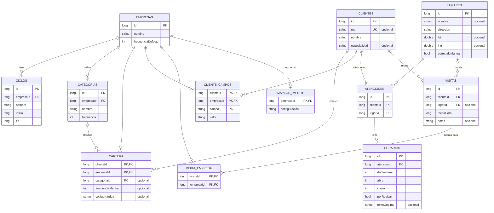

# Base de datos

Visenda guarda todo en una base Room (SQLite) dentro del teléfono, **cifrada con SQLCipher** (ver [Cifrado](#cifrado)). El modelo está en [`Entidades.kt`](../app/src/main/java/cl/visenda/app/data/Entidades.kt) y cada versión del esquema queda en [`app/schemas/`](../app/schemas/) para las migraciones.

## Diagrama

## Tablas

| Tabla | Para qué sirve |
|---|---|
| `empresas` | Cada laboratorio o empresa que el visitador representa, con su frecuencia de visitas por defecto. |
| `ciclos` | Períodos de trabajo de una empresa (por ejemplo, un mes). Las visitas se cuentan dentro de cada ciclo. |
| `categorias` | Clasificación de clientes de una empresa (A, B, C…), cada una con cuántas visitas pide por ciclo. |
| `clientes` | Las personas que se visitan. El RUT es único, pero opcional. |
| `cartera` | Une clientes con empresas: un mismo médico puede estar en la cartera de varias, con distinta categoría en cada una. `codigoKardex` permite reimportar sin duplicar. |
| `cliente_campos` | Columnas del kardex sin campo propio (cumpleaños, teléfono…), guardadas por empresa. |
| `lugares` | Edificios o consultas. Se geocodifican una sola vez aunque atiendan varios clientes. `corregidoManual` evita que una reimportación pise un pin corregido a mano. |
| `atenciones` | "El cliente X atiende en el lugar Y". Es lo que permite clientes con varias oficinas. |
| `horarios` | Tramos de atención de cada oficina. Un horario partido son varias filas el mismo día. `porRevisar` marca los que el importador no pudo leer. |
| `visitas` | Cada visita hecha: a quién, dónde, cuándo y notas. |
| `visita_empresa` | Para qué empresas cuenta una visita; una sola visita puede sumar en varias. |
| `mapeos_import` | Qué columna del Excel es qué, recordado por empresa para no preguntarlo en cada importación. |

## Convenciones

- **Fechas** (`inicio`, `fin`): días desde el 1 de enero de 1970 (`LocalDate.toEpochDay`).
- **Horas del día** (`abre`, `cierra`): minutos desde las 00:00. Por ejemplo, 9:30 es `570`.
- **Instantes** (`fechaHora`): milisegundos desde epoch.
- **`diaSemana`**: 1 = lunes … 7 = domingo.
- **Borrado en cascada:** eliminar un cliente o una empresa borra todo lo que depende de él (cartera, ciclos, campos, oficinas, visitas…), para cumplir el derecho de supresión de la Ley 21.719. Si se borra una categoría, sus clientes quedan sin categoría; si se borra un lugar, sus visitas se conservan sin lugar.

## Cifrado

- La base (`visenda.db`) está cifrada con [SQLCipher](https://www.zetetic.net/sqlcipher/) (AES-256). Sin la clave, el archivo es ilegible aunque alguien lo copie del teléfono.
- La clave son 32 bytes al azar generados la primera vez. Se guardan envueltos por una llave del **Android Keystore**, que no se puede extraer del teléfono. Ver [`BaseCifrada.kt`](../app/src/main/java/cl/visenda/app/data/BaseCifrada.kt).
- Una base sin cifrar (de una versión anterior de la app o recién restaurada desde un respaldo) se cifra sola al abrirse. La original se conserva hasta confirmar que la cifrada quedó bien.
- Como la clave queda atada al teléfono, para cambiar de equipo se usa el **respaldo cifrado** (`.visenda`): lleva una copia de la base descifrada, cifrada a su vez con AES-256-GCM y la contraseña del usuario (PBKDF2). Ver [`Respaldo.kt`](../app/src/main/java/cl/visenda/app/respaldo/Respaldo.kt).
- Si se borran los datos de la app o se desinstala, la clave se pierde y la base no se puede recuperar: solo queda restaurar un respaldo.
